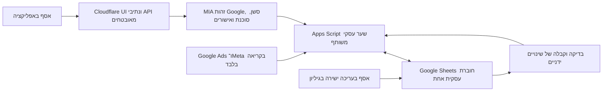

# תוכנית איחוד וביצוע Assaf OS

עודכן 12.10.2026, ישראל. תוכנית המוצר הנוכחית בעקבות החלטת אסף: Cloudflare, כניסת Google, Google Sheets משותף אחד, Apps Script ו־MIA. אסף עורך גם באפליקציה וגם ישירות בגיליון. MIA מציעה שינויים ומבצעת אותם רק לאחר אישור. התוכנית מחליפה את כיוון ה־OS הקודם; היא אינה הצהרה שהמערכת כבר פועלת עם מידע אמיתי.

## המוצר שנמסור

אפליקציה פרטית בעברית שעוזרת לנהל שני מסלולים, לימוד ואוטומציה. אפשר להוסיף ליד בפחות מחצי דקה, להמיר אותו ללקוח, לתעד עבודה, תקבול ושעות, לראות הכנסה לשעה ולסגור משימות. לכל הנתונים העסקיים יהיה מקום אחד בגיליון. כל סכום מסכם מחושב מרשומות מקור, והסכומים באפליקציה ובגיליון חייבים להתאים.

ל־OS יהיה אירוח Cloudflare ללא VM נוסף. הכניסה לאפליקציה תהיה Google. MIA הקיימת ממשיכה להריץ את הסוכנת ואת מנגנון ההצעות והאישורים. סגירת שרת הבדיקות של ה־OS אינה סגירת שרת MIA. ביטול התלות בכניסת Telegram ל־OS אינו מחיקה אוטומטית של הבוט שמשמש את MIA כיום.

## המבנה המשותף

Cloudflare מגיש את הממשק ומעביר רק נתיבים מורשים. Apps Script אחראי לסכימה, לכתיבה העסקית, לבדיקת הרשומות, לקבלות ולחישובים. MIA משתמשת באותו שירות ובאותו מזהה חוברת, בלי גיליון כספים נוסף או מקור עצמאי לסכומי הלקוחות. קובצי חוזה, חשבונית או חומרי עבודה נשמרים ב־Drive; בגיליון שומרים קישור בלבד.

ה־OS שנכתב עד עכשיו משתמש ב־PostgreSQL כמקור CRM וב־Sheets כמקור כספים. זו נקודת המוצא, ולא ארכיטקטורת היעד החדשה. מעבר אנשי הקשר והלידים מחייב שינוי מפורש של מתאמי CRM וקליטת האתר. עד מעבר מאומת, PostgreSQL נשאר הסמכות של קליטת הלידים הקיימת, והמערכת החדשה אינה כותבת אליה במקביל. לאחר המעבר, החוברת היא סמכות הנתונים העסקיים; PostgreSQL יכול להישאר לתולדות שיחה, סשנים, תור קליטה, אישורים וקבלות טכניות. אם נשארת בו תצוגת אנשי קשר לצורך תאימות, היא נגזרת מהגיליון ואינה מקור עסקי נוסף לעריכה.

## הטבלאות בעברית

בתצוגה הרגילה מופיעות רק העמודות שעוזרות לעבודה. מזהה קבוע, גרסה, מקור ועדכון אחרון נשארים בעמודות מערכת מוגנות. טלפון נשמר כטקסט כדי לשמור על אפס בתחילתו. בחירת לקוח בטופס מציגה שם ומקשרת למזהה, ולא לשורה או לשם שעלולים להשתנות.

| לשונית | מה מזינים | מה מוצג או מחושב |
|---|---|---|
| סיכום | בחירת חודש ומסלול | תקבולים, הוצאות ששולמו, תזרים נטו, שעות מתועדות, הכנסה לשעה, לידים לטיפול ומשימות קרובות |
| לידים | שם, טלפון, מייל, מסלול, סטטוס; מקור והערה ברשות | חדש, רלוונטי, לא רלוונטי, לא ענה, הפך ללקוח; קישור ללקוח לאחר המרה |
| לקוחות | שם, טלפון, מייל, פעיל או לא פעיל | התקבל מלימוד, התקבל מאוטומציה, סה״כ התקבל, שעות לכל מסלול, הכנסה לשעה לכל מסלול ובסך הכול |
| עבודות | לקוח, מסלול, שם העבודה, סכום שסוכם, תאריך התחלה, סטטוס | סכום שהתקבל, שעות, הכנסה לשעה; לימוד יכול להיות סדרת מפגשים ואוטומציה יכולה להיות פרויקט |
| תקבולים | תאריך, לקוח, עבודה ומסלול, סכום שהתקבל, אמצעי תשלום; אסמכתה ברשות | תקבול, החזר, בוטל; רק כסף שהתקבל בפועל נכנס להכנסה |
| שעות עבודה | תאריך, לקוח או עבודה, מסלול, דקות, סוג פעילות; הערה ברשות | שעות מחושבות; כלולים מפגש, הכנה, פיתוח, תיקונים, תמיכה ומכירה כשמשויכים ללקוח |
| הוצאות והשקעות | תאריך, ספק, קטגוריה, פלטפורמה, מסלול או משותף, סכום, מטבע, שולם או צפוי; אסמכתה ברשות | Meta, Google Ads, כלים, AI, אירוח, קבלני משנה ואחר; הוצאות כלליות אינן משויכות שרירותית ללקוח |
| משימות | משימה, תאריך יעד, סטטוס, עדיפות; לקוח ועבודה ברשות | לביצוע, בתהליך, ממתין, בוצע, בוטל; משימה כללית מותרת |
| הגדרות | רשימות הבחירה והעדפות תצוגה | מסלולים, סוגי פעילות, קטגוריות, אזור זמן ומטבע ראשי; ללא סודות |

לוח חיובים צפויים והנתונים הגולמיים של הפרסום יופיעו באזור מתקדם כאשר נדרש פירוט. קבלות, רישום שינויים וקונפליקטים הם לשוניות מערכת באותה חוברת. לא פותחים גיליון חדש בכל חודש. הסיכום החודשי מכיל שורה לכל חודש ועמודות נפרדות לשני המסלולים.

אסף הבהיר בשיחה הקודמת ש־creative outcome מתייחס להוצאות והשקעות. לכן אין להוסיף מאגר מדיה כחובה לגרסה הראשונה. אפשר לצרף קישור לתוצר או מודעה לרשומת הוצאה או עבודה קיימת.

אותו אדם יכול לרכוש בשני המסלולים. המסלול שייך לעבודה, לתקבול ולדיווח הזמן; לא מחייבים לקוח להשתייך למסלול אחד. המרת ליד ללקוח שומרת את זהותו ואת ההיסטוריה ומסמנת את הליד כהומר. אין זיהוי אוטומטי לפי שם בלבד. התאמה עמומה של טלפון או מייל מוצגת לבחירה לפני איחוד.

## חישובים שאפשר ללמוד מהם

תקבולים הם סכומי קבלות שנרשמו כהתקבלו, בניכוי החזרים תקפים. סכום שסוכם, הצעה, חיוב עתידי או אירוע המרה בפלטפורמת פרסום אינם הכנסה שהתקבלה. החזר מקושר לתקבול המקורי; אין מחיקה של הכנסה היסטורית כדי לתקן אותה.

שעות לקוח הן סכום הדקות המתועדות חלקי 60. הכנסה לשעה היא התקבולים נטו חלקי השעות. מחשבים בנפרד לימוד, אוטומציה והסך הכול. לסך הכול מחלקים את סך התקבולים בסך השעות, ולא ממוצע של תעריפים. אם לא תועד זמן, מוצג ״חסרים דיווחי זמן״ והערך אינו אפס. גם כשיש זמן, המדד מסומן ״לפי השעות שתועדו״; אין טענה שכל זמן העבודה נמדד.

לדוגמה סינתטית בלבד: 1,200 ₪ מלימוד ו־4 שעות מתועדות נותנים 300 ₪ לשעה. 3,000 ₪ מאוטומציה ו־10 שעות נותנים 300 ₪ לשעה. הסך הכול הוא 4,200 חלקי 14. הדוגמה שייכת לבדיקות ואינה מוכנסת לחוברת האמיתית.

החודש נקבע מתאריך קבלת הכסף באזור הזמן ישראל. עבודה שלא פעילה עוד נשארת בהיסטוריה. תזרים נטו חודשי הוא תקבולים פחות הוצאות ששולמו, עם כיתוב שאינו רווח חשבונאי. עלות ישירה ללקוח יכולה להציג תרומה אחרי העלות; שעות והוצאות כלליות שאינן משויכות מוצגות בנפרד. לא מחלקים אותן בין מסלולים ללא כלל שהבעלים בחר.

הזנה בשקלים נשארת קריאה לאדם. שירות הכתיבה ממיר לאגורות שלמות; עיגול, ערכים שליליים, ביטולים והחזרים נבדקים לפי סוג הרשומה. שומרים מטבע מקור. מטבעות שונים אינם מתחברים אוטומטית: נדרשים סכום שקלי מאומת או שער מתועד ותאריך. סטטוס מקור חסר, חלקי או ישן מוצג לצד הנתון; כשל מקור אינו הופך לאפס.

## הממשק

שומרים עברית מימין לשמאל, Rubik ושפה חזותית עקבית עם הממשק הקיים. ניווט רגיל: היום, לידים, לקוחות, העסק. בתוך העסק: הכנסות, שעות, הוצאות ומשימות. ״+ חדש״ מציע ליד, תקבול, זמן, הוצאה או משימה. כפתור ״פתח בגיליון״ פותח את אותה חוברת, ובכרטיס לקוח יש קישור לרשומה שלו.

באייפון רשומות מוצגות בכרטיסים קצרים, ובמחשב בטבלאות עם סינון. טופס ליד מתחיל בארבעת השדות שם, טלפון, מייל ומסלול; חייבים שם ואמצעי קשר אחד, לא גם טלפון וגם מייל. סטטוס חדש הוא ברירת מחדל. תיעוד זמן מציע לקוח, סוג פעילות ודקות, בלי לדרוש תיאור ארוך. שדות מערכת, הגדרות API ופרטי תשתית אינם חלק מטופסי היומיום.

מצבי שמירה נפרדים: ״בודק״, ״נשמר״, ״יש שינוי שצריך לבדוק״, ״בודק אם נשמר״. אין הודעת הצלחה לפני קבלה מהשרת. עריכה של MIA מוצגת ככרטיס אישור: השדות המדויקים, הלקוח, הסכום והשינוי לפני ואחרי. כניסת Google ופעולות אישור באפליקציה אינן דורשות Telegram. הוספה למסך הבית באייפון נבדקת עם כניסה חוזרת, רענון והתנתקות.

## עריכה ישירה בלי לאבד שינויים

הבעלים רשאי לערוך עמודות קלט ישירות. נוסחאות, מזהים וכותרות מוגנים להקטנת טעויות, אבל הגנה אינה מונעת מבעל החוברת לשנות אותם. שינוי מבני או נוסחה שנמחקה יוצר הודעת תקינות בעברית, ולא ניסיון לדרוס את התיקון של הבעלים.

Apps Script משתמש בנעילת סקריפט לכותבים דרך השירות. נעילה זו אינה נועלת את ההקלדה הישירה ב־Sheets. לכן אין להבטיח עריכה סימולטנית נטולת התנגשויות. השירות קורא מחדש את הרשומה ואת טביעת תוכנה לפני שמירה, ומשתמש בגרסה צפויה ובקבלה עמידה. שינוי ידני שלא התקבל לבקרה חוסם כתיבה לאותה רשומה עד בדיקה. קונפליקט אינו נפתר אוטומטית על ידי העדפת MIA.

טריגר עריכה מותקן מטפל בעריכה ידנית, במילוי מזהים ובבדיקות. כותבים דרך Apps Script או Sheets API קוראים את אותה לוגיקת הבדיקה במפורש: טריגר עריכה אינו מופעל עבורם. בדיקה מחזורית משלימה פערים, הדבקה מרובת תאים וטריגר שנכשל. עד שהנתונים תקפים, הסיכום מציג כיסוי חלקי ורשומות לבדיקה, ולא טוען להתאמה מלאה. [מגבלות טריגרים של Google](https://developers.google.com/apps-script/guides/triggers/installable), [נעילות Apps Script](https://developers.google.com/apps-script/reference/lock/lock-service).

הקוד הכספי הקיים דוחה שינוי ישיר שלא תואם את רישום הקבלות. לכן תמיכה בעריכה הישירה החדשה היא עבודה נדרשת, ולא יכולת שאפשר להפעיל בדגל. מטמיעים אותה תחילה בחוברת בדיקה; בדיקת dry-run משווה סכימה, זהויות, תקבולים ושעות לפני כל התקנה בחוברת שנבחרה.

## החיבורים וה־API

| רכיב | מה מחברים | דרך וקבלה נדרשת |
|---|---|---|
| Cloudflare | Static Assets ו־Worker אחד | נתיבי auth ו־API לפני fallback של קבצים, יעד HTTPS קבוע, no-store, גודל וזמן מוגבלים, בלי כתובות ספק שרירותיות; ללא bindings בתשלום |
| כניסת Google | Google Identity Services | אימות חתימה, issuer, audience, expiry ו־nonce בשרת; Google subject מאושר ממופה לבעלים הקיים; cookie מאובטח, CSRF, logout ו־revocation |
| Apps Script | פרויקט אחד המחובר לחוברת | doPost חתום בין שרתים; מזהה חוברת ו־workspace נעולים, timestamp, מזהה בקשה, גרסה וקבלה. אין סוד בדפדפן ואין כתיבה בלתי חתומה |
| MIA | כלים עסקיים ואישורי בעלים | קריאת אותו שירות; הצעה בלתי משתנה שפגה, אישור ואימות מחדש של היעד; תוצאה לא ודאית נפתרת בקריאת אותה קבלה ללא שליחה חוזרת |
| אתר → ליד | מסלול הקליטה שכבר נבנה | source_id ומפת המזהים נשמרים. בתור המעבר מזהים מועד מעבר ברור; לאחריו ההעברה החתומה לגיליון היא הכתיבה העסקית הקנונית |
| Google Ads | נתוני שימוש בפרסום | חיבור קריאה בלבד, חשבון וקמפיינים מאושרים, סכומים לפי יום ומטבע. בחירת API וההרשאות לאחר בדיקת חשבון; הזנה ידנית/CSV זמינה קודם |
| Meta | Marketing API Insights | הרשאת קריאה מתאימה ובדיקת חשבון ופקיעת גישה. אין שינוי מודעות, קהלים או תקציב דרך MIA |
| Drive | מסמכים ואסמכתאות | קישור למסמך קיים; יצירה או שיתוף נעשים רק בפעולה מאושרת, בלי שכפול קבצים לחוברת |

Google login לא מעניק הרשאת Sheets. השירות העסקי משתמש בהרשאות הפרויקט ובחתימה בין שרתים. Apps Script יכול להגיש ממשק וטפסים, אך הממשק החיצוני ב־Cloudflare אינו משתמש ב־google.script.run; הוא פונה ל־Worker ולשירות השרת. Google תומכת בפריסת Apps Script באמצעות doGet/doPost. [Web Apps](https://developers.google.com/apps-script/guides/web), [אימות Google](https://developers.google.com/identity/gsi/web/guides/verify-google-id-token), [Cloudflare Static Assets](https://developers.cloudflare.com/workers/static-assets/).

חוזה היעד המוצע: GET /api/os/summary, /leads, /clients, /clients/{id}, /work, /payments, /time, /expenses, /tasks; GET /api/os/schema; POST /api/os/proposals; POST /api/os/approvals/{id}; GET /api/os/receipts/{request_id}. זהו תכנון לנתיבים מאוחדים, ולא רשימת endpoints שכבר קיימים. מתאם ההגירה ממפה את ה־business endpoints הקיימים בלי לשנות את משמעות הקבלות הישנות. אין generic spreadsheet write ואין tool שיכול לכתוב לטווח שרירותי.

נתוני Ads הם ״עלות פרסום מדווחת״, לא בהכרח חיוב ששולם. הם נשמרים בנפרד מהוצאות מזומן, עם מפתח ייחודי פלטפורמה/חשבון/תאריך/קמפיין/מטבע ומקור עדכון. יבוא חוזר מעדכן אותה רשומה. הזנה ידנית ואוטומטית לא נספרות פעמיים. קבלה או חיוב ששולמו מתחברים להוצאות, לאחר התאמה. ליד ממודעה אינו הכנסה; ROAS או עלות רכישת לקוח מוצגים רק עם שיוך שניתן להוכיח. [היכרות עם Google Ads API](https://developers.google.com/google-ads/api/docs/get-started/introduction).

## איחוד הקוד והמידע

| מה קיים | מה שומרים | מה מחליפים |
|---|---|---|
| MIA Business Ledger | חתימות, בדיקות רשומה, קבלות, אישורים, הגנות מפני שליחה כפולה | חוזה TEST בלבד וסכימה טכנית שאינה כוללת מסלולים, זמן ולקוח באופן הנדרש |
| frontend הקיים | עברית RTL, Rubik, תצוגות לאייפון ומצבי מידע חסר | כניסת Telegram כברירת מחדל, תצוגת העסק הישנה ונתיבים הקשורים למקור CRM נפרד |
| התאמות Cloudflare ו־Google המקומיות | Worker, אריזת קבצים, אימות Google ומיפוי בעלים | ההפניות והמסמכים הישנים; לא מניחים ששינוי מקומי נפרס |
| CRM_Package | חוברת אחת, טפסים קצרים, נוסחאות, מזהים והפרדת קלט מחישוב | מיתוג, נתוני לקוחה וקוד גישה משותף; אין העתקת נתוני לקוחה למוצר של אסף |
| CRM וקליטת האתר | מזהים, היסטוריה ו־source receipts | כותבי CRM מקבילים לאחר מועד המעבר |

מרכזים תוכנית זו כקובץ הפעיל. עובדים בענפי איחוד מבודדים מעל גרסאות Business הקיימות. שינויים לא שמורים בענפי Google ו־Cloudflare נלקחים רק ברשימת קבצים מפורשת, עם hash ובדיקה. לא מאפסים ענפים, לא מוחקים worktrees עם עבודה ולא ממזגים PRs אוטומטית.

מעבר נתונים: מיפוי לקוחות ומזהים → dry-run של סכימה וכפילויות → השוואת ספירות וסכומים → קבלת שינויים ידניים והיסטוריית סטטוסים → פיילוט עם רשומות שהבעלים בחר → קביעת כותב קנוני אחד → ביטול הכותב הישן. רשומה ללא סכום מאומת נשארת ללא הכנסה. ליד אינו מקבל סטטוס לקוח משלם עקב הופעתו ב־CRM. אין יבוא היסטורי או שינוי לקוחות חיים במהלך הבדיקות המקומיות.

## סדר הביצוע ומצבו

| שלב | תוצר בדיק | מצב בתחילת הביצוע |
|---|---|---|
| 1 סגירת עלות ישנה | inventory מדויק, חומר שחזור מקומי, מחיקת VM/disk/IP של OS בלבד ואימות העדרם | PASS ב־12.10.2026: שלוש המטרות אינן קיימות; אותו שרת MIA עדיין RUNNING; ראיות ב־[דוח הניקוי](../ops/assaf-os/CLEANUP_REPORT.md) |
| 2 בסיס מאוחד | שני worktrees עצמאיים עם הקוד העסקי והתאמות Google/Cloudflare | בוצע מקומית; טרם מיזוג או פרסום |
| 3 חוברת וחישובים | סכימה עברית אחת, בדיקות הכנסה/שעות, preflight והתקנת Apps Script שאינה דורסת קיים | בסיס מקומי PASS: 23 בדיקות, סכימה ומתקין; אין עדיין נוסחאות מאוכלסות או סנכרון לחוברת אמיתית |
| 4 כתיבה ישירה משותפת | יצירה/עדכון מכל ערוץ, מילוי מזהים, קבלת עריכות, קונפליקטים והמרת ליד | נדרש מימוש וחיבור ל־LIVE |
| 5 ממשק יומי | טפסים קצרים, לקוח בשני מסלולים, סיכום חודשי, משימות והקישור לגיליון | נדרש חיבור לסכימה החדשה ושימוש אמיתי |
| 6 MIA | כלים לקריאה ולהצעות על אותה חוברת, אישור מתוך OS, recovery וקבלות | מנגנון אישורים TEST קיים; כלי הסכימה החדשה נדרשים |
| 7 חיבורים | האתר, Google Ads, Meta ו־Drive במקורות מוגדרים | הרשאות, חשבונות וסנכרון נדרשים; ידני/CSV קודם לחיבור Ads |
| 8 מעבר | חוברת אמיתית שנבחרה, מיפוי CRM, כותב יחיד והפסקת מסלולים ישנים | נדרש dry-run וביצוע בהיקף נתונים מאושר |
| 9 קבלה | כניסה Google אמיתית, Chrome/Safari/Home Screen, התאמת גיליון/OS/MIA ושחזור | נדרשת בדיקה אמיתית; אינה מוכחת מנתונים סינתטיים |

תלויות ליניאריות: סכימה → שער כתיבה ובקרת עריכה → API MIA → מסכי OS → חיבור הנתונים האמיתיים → בדיקת מכשיר. סגירת עלות סביבת הבדיקות הישנה עצמאית ויכולה לקרות לפני שהכתובת החדשה זמינה, בהתאם לבקשת אסף להפסיק לשלם. בינתיים הכתובת הישנה לא תהיה זמינה.

## ניקוי Google Cloud הישן

מטרות שאומתו בבדיקת metadata ב־12.10.2026: פרויקט tomibot-telegram; VM owner-os-staging באזור me-west1-a; boot disk בשם זהה, 20GiB, autoDelete=true; כתובת סטטית owner-os-staging-ip באזור me-west1, 34.0.74.144. שרת MIA הפעיל הוא mia בפרויקט mia-assafweb והוא מחוץ להיקף הניקוי.

הסביבה הישנה מכילה DB ונתוני בדיקה סינתטיים. לפני מחיקה שומרים את חבילת המקור, image archive המאומת, manifests ותהליך שחזור מקומי שכבר קיימים. credentials של staging לא נשמרים בחבילה וייווצרו מחדש אם נדרש שחזור. אין יצירת snapshot בתשלום כחלק משגרת הניקוי.

סדר: מחיקת VM עם boot disk → שחרור הכתובת הסטטית → בדיקת היעדר VM, disk וכתובת → בדיקת משאבים נלווים ייעודיים. עצירת VM לבדה אינה מספקת כי הדיסק והכתובת יכולים להמשיך להיות מחויבים. לא מוחקים פרויקט, default network, build bucket, Artifact Registry או משאבי MIA. חוקים ורשת ייעודיים אפשר לנקות אחרי בדיקת dependencies; הם אינם הוכחת הפסקת החיוב.

Cloudflare מיועד למסלול Free וללא רכיבים בתשלום. השירות עדיין כפוף למכסות; אין התחייבות שכל עלויות MIA, AI, Workspace או שירותי צד שלישי יהיו אפס. קבלה היא היעדר המשאבים הישנים ובדיקה מאוחרת של חיובים חדשים, כשחשבונית יכולה להציג שימוש שהיה לפני המחיקה. [תמחור Cloudflare](https://developers.cloudflare.com/workers/platform/pricing/), [מכסות Apps Script](https://developers.google.com/apps-script/guides/services/quotas).

## תנאי מסירה

- הוספת ליד קצרה, עם שם ואמצעי קשר אחד; עריכה ישירה ועריכת OS נראות בקריאה הבאה של MIA.
- ליד מומר פעם אחת; אותו אדם יכול להיות לקוח לימוד ואוטומציה, וההיסטוריה נשמרת.
- שני תקבולים חלקיים, החזר ודיווחי זמן משני מסלולים מייצרים סיכום לקוח וחודש מדויק; סכום עבודה אינו נספר כהכנסה.
- זמן חסר, מטבע אחר, מקור לא זמין ושינוי ידני שלא אומת מוצגים במפורש ואינם הופכים לאפס או לנתון מלא.
- MIA אינה כותבת לפני אישור. שינוי הלקוח אחרי ההצעה פוסל אותה; timeout לאחר commit נפתר בקבלה ללא כפילות.
- שתי עריכות לאותה רשומה, paste של כמה שורות, שינוי כותרת וטריגר שנכשל נבדקים. אין הבטחה ש־LockService נועל עריכה אנושית.
- יבוא Ads חוזר אינו מכפיל עלות; אין עירוב עלות שימוש, תשלום בפועל ותקבולי לקוחות.
- משתמש Google לא מאושר, CSRF, session שפג, logout ו־revocation נדחים בלי לקרוא מידע לקוחות.
- Chrome, Safari ואפליקציה ממסך הבית קוראים אותה חוברת. במסכים רגילים אין נתוני הדגמה.
- סכומי OS, גיליון ותשובת MIA זהים עבור אותו מקור, כיסוי וזמן תצפית.
- סקירה עצמאית, בדיקות רלוונטיות, רגרסיות Mia ו־Worker עוברים; תוצאות מקומיות מסומנות בנפרד מחיבור אמיתי וקבלת אסף.
- VM, disk ו־IP הישנים אינם קיימים; MIA נשארת פעילה. חשבון Cloudflare אינו משודרג אוטומטית והחיוב הנוסף של OS אינו ממשיך ממשאב ישן.

הפעלה בחשבונות אמת, הרשאות Google/Meta, פריסה ושינוי CRM חי מבוצעים מול מטרות קונקרטיות ואישור מתאים. התכנון והביצוע המקומי אינם מעידים שהגיליון האמיתי כבר נבחר, שחיבור MIA החדש חי או שהמוצר נמסר.

## אימות הביצוע המקומי

הקוד אוחד בענפים מבודדים מעל בסיסי Business הקיימים. שינויי Google ו־Cloudflare נלקחו מרשימת קבצים מפורשת; ענפי המקור לא נערכו במסגרת האיחוד. אין merge ל־master/main ואין פרסום האפליקציה.

- רגרסיית Python המלאה הסתיימה בקוד יציאה 0. פלט ההתקדמות השמור מכיל 3,043 הצלחות ו־108 דילוגים; בדיקות הדורשות PostgreSQL חי או הרשאות חיצוניות אינן הופכות לדיווח על בדיקה חיה.
- Ruff ובדיקות התנהגות ה־widget עברו.
- בדיקות ה־frontend, Worker והאריזה: 102 הצלחות, 0 כישלונות.
- אריזת שמונת קובצי הממשק ו־Cloudflare bundle dry-run עברו. מצב הכניסה והכתיבה נשאר כבוי בתצורת ההפצה; dry-run אינו פריסה.
- בסיס הטבלאות: 23 הצלחות, כולל פיצול מסלולים, הכנסה משוקללת, זמן חסר, החזרים מקושרים, מטבעות, כפילויות ומזהים.
- הסקירה העצמאית מצאה ותיקנה דחייה של עוגיית מחיקה תקפה של Starlette, פורמט טלפון, וקבלת החזר ללא תקבול מקורי. לאחר בדיקה חוזרת: PASS לבסיס המקומי, ואין P1/P2 פתוחים בסקירה זו.

מצב המוצר: בסיס ותוכנית מוכנים להמשך ביצוע; NO-GO להצגתו כמוצר חי ומסונכרן. הצעד הבא הוא שער הכתיבה המשותף, קבלת עריכות ישירות ועדכון מתאמי MIA לסכימה החדשה. אחריהם נוסחאות ותצוגות, חוברת LIVE, כניסה אמיתית ובדיקת אייפון. כלי Chrome נכשל בשלב קריאת מדיניות הלשוניות בשיחה זו, לכן הכניסה שדווחה על ידי אסף ל־Cloudflare לא אומתה עצמאית כאן.
